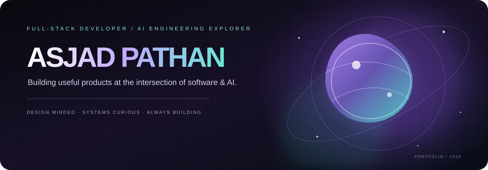
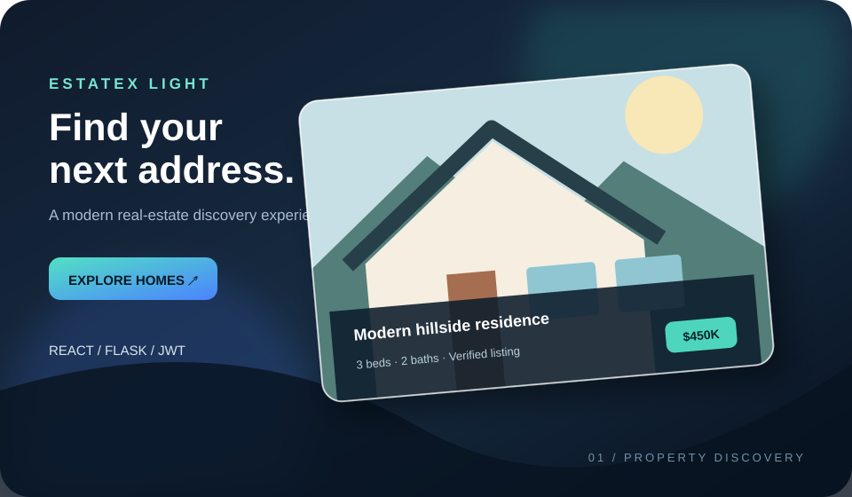
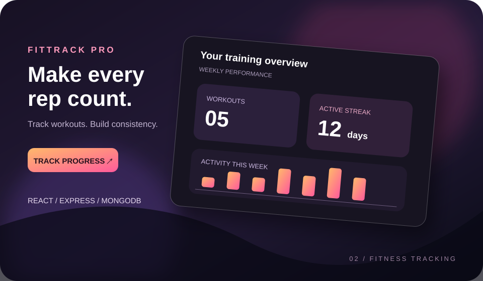
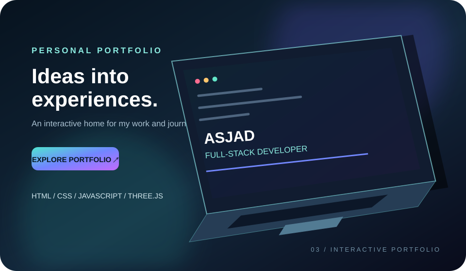

 

 

---

<table>
<tr>
<td width="58%" valign="top">

### THE PERSON BEHIND THE BUILDS

I'm **Asjad Afzal Pathan**, a Computer Science & Engineering student based in Pune, India.

I enjoy turning ideas into working software — from thoughtful interfaces and backend workflows to exploring practical AI integrations.

- **Building:** Full-stack web applications
- **Exploring:** AI-powered product experiences
- **Learning:** Software engineering, databases and system design
- **Mindset:** Build → test → learn → improve

</td>
<td width="42%" align="center" valign="middle">

 

**ASJAD PATHAN**

Developer · Builder · Learner

  

📍 Pune, India

</td>
</tr>
</table>

## WHAT I WORK WITH

These icons represent technologies present in my learning and project work — not expert-level proficiency in every tool.

## SELECTED PROJECTS

<table>
<tr>
<td width="50%" valign="top">

### EstateX Light

A real-estate web application with property discovery, search filters and account workflows.

REACT · FLASK · JWT

**[SOURCE CODE ↗](https://github.com/Asjadpathan31/EstateX-light)**
</td>
<td width="50%" valign="top">

### FitTrack Pro

A fitness-tracking application with workout records, streak tracking and progress history.

REACT · EXPRESS · MONGODB

**[SOURCE CODE ↗](https://github.com/Asjadpathan31/fittrack-pro)**
</td>
</tr>
<tr>
<td colspan="2" align="center">

### Personal Portfolio

An interactive personal website with a real-time Three.js hero experience.

HTML · CSS · JAVASCRIPT · THREE.JS

**[LIVE WEBSITE ↗](https://asjadpathan31.github.io/portfolio/)** · **[SOURCE CODE ↗](https://github.com/Asjadpathan31/portfolio)**
</td>
</tr>
</table>

Project illustrations are custom concept artwork. They are not screenshots of verified live application screens; use the source repositories to inspect implementations.

## GITHUB / BUILDING IN PUBLIC

 

 

## LET'S CONNECT

**Interested in building something useful together?**

<a href="https://www.linkedin.com/in/asjad-pathan/">LINKEDIN ↗</a> &nbsp; · &nbsp;
<a href="https://github.com/Asjadpathan31">GITHUB ↗</a> &nbsp; · &nbsp;
<a href="https://asjadpathan31.github.io/portfolio/">PORTFOLIO ↗</a>

  

MAKE IT WORK. MAKE IT CLEAR. MAKE IT BETTER.

